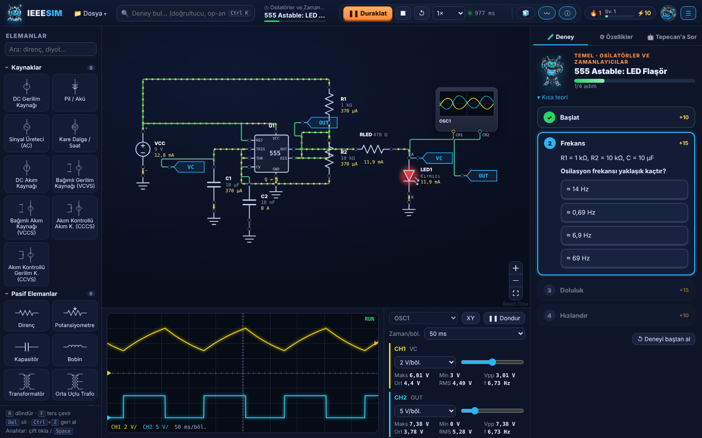
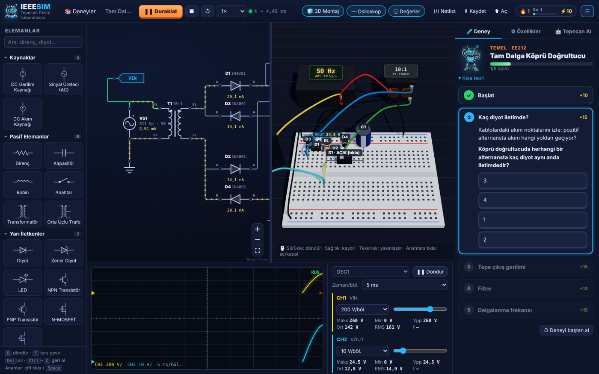

# IEEESIM · Tepecan Devre Laboratuvarı

> Elektrik öğrencileri için simülasyon aracı — depo: [k-gumus/EESIM](https://github.com/k-gumus/EESIM) · Lisans: MIT

Web tabanlı, 3D destekli ve yapay zekâ destekli elektronik devre simülatörü — IEEE Yeditepe için, EE212 laboratuvarı odaklı, tamamen Türkçe.




## Hızlı başlangıç

**Kurulumsuz deneme:** `IEEESIM.html` dosyasına çift tıkla. Tek dosyalık sürümdür; simülasyon, 3D montaj, deneyler ve Tepecan’ın kural tabanlı hata ayıklayıcısı çalışır. (Tarayıcı içi WebLLM bu sürüme gömülmez; Ollama kullanılabilir.)

**Geliştirme (Node.js 18+):**

```bash
npm install
npm run dev          # http://localhost:5173
npm test             # 65 test: motor, 49 deneyin quiz cevapları, bilgi kartları, eşitleme
npm run build        # dist/  → Cloudflare Pages / GitHub Pages / Vercel
npm run build:single # dist-single/index.html → tek dosyalık sürüm (giriş/bulut yok, misafir modu)
npm run dev:api      # build + Cloudflare Pages Functions yerelde (giriş, ilerleme, datasheet, Tepecan’a Sor)
npm run deploy       # Cloudflare Pages’e yayınla — kurulum: docs/CLOUDFLARE.md
```

> Proje OneDrive klasöründe olduğu için `node_modules` (≈300 MB) senkronizasyonu yavaşlatabilir. Geliştirmeyi OneDrive dışındaki bir klasörde (ör. `C:\dev\IEEESIM`) yapman önerilir.

## Özellikler

| Bölüm | Ne yapıyor |
|---|---|
| **Palet** | 45 eleman: R, C, L, potansiyometre, anahtar, buton, trafo, diyot (1N4001/1N4148/1N5819), zener, LED, lamba, LDR, NTC, NPN/PNP/N-P MOSFET (2N3904, BC547, 2N2222, 2N7000, IRF540… hazır modeller), op-amp (LM741/TL081/LM358), 555, 7805, AND/OR/NOT/NAND/NOR/XOR, D flip-flop, lojik giriş/gösterge, DC/AC/saat/akım kaynağı, pil, bağımlı kaynaklar (E/G/F/H), multimetre, osiloskop |
| **Bilgi kartları** | Her eleman için: ne işe yarar, nasıl çalışır, formül, tipik değerler, dikkat edilecekler, kılıf/sınır değerler, datasheet bağlantıları; kendi PDF’ini yükle (misafirde tarayıcıda, girişte bulutta) |
| **Canvas** | React Flow; sürükle-bırak, 20 px ızgara, `R` döndür, `F` ters çevir, `Space`/çift tık anahtar, `Ctrl+Z/Y` |
| **Canlı akım** | Kablo rengi = düğüm gerilimi (yeşil +, kırmızı −), hareketli noktalar = akım yönü ve büyüklüğü (KCL ile kablo ağacından hesaplanır) |
| **Osiloskop** | 2 kanal, tetikleme, 1-2-5 V/böl. ve zaman/böl., Maks/Min/Vpp/Ort/RMS/frekans ölçümleri, XY modu |
| **Multimetre** | V⎓, V∿ (true-RMS), A⎓, A∿ — ampermetre gerçekten 0 Ω seri eleman olarak çözülür |
| **3D Montaj** | Netlist’ten otomatik breadboard yerleşimi; renk kodlu dirençler, yanan LED, tıklanabilir anahtar, canlı ekranlı cihazlar |
| **Deney kataloğu** | 12 konu başlığı (DC, geçici rejim, AC, filtreler, diyot, BJT, MOSFET, op-amp, osilatör, güç, dijital, ölçme); 49 etkileşimli föy + 66 “yakında” deney; adım adım görevler, otomatik kontrol, quiz, XP / seviye / günlük seri |
| **Hesap** | Google ya da e-posta ile giriş, misafir modu; XP ve ilerleme her cihazda (Cloudflare D1) |
| **Tanıtım turu** | İlk girişte Tepecan’lı spot ışıklı tur; sonraki girişlerde “kaldığın yer” kartı ve yenilikler |
| **Tepecan’a Sor** | Netlist + simülasyon sonuçlarını okur; teorik mentor, lab asistanı, hata ayıklayıcı. Önerdiği düzeltmeyi tek tıkla uygular. Varsayılan: Tepecan Bulut (Workers AI, günlük kota); Ollama ve WebLLM de seçilebilir |

## Mimari

```
Canvas (React Flow) ──► compile.ts ──► netlist (net + eleman listesi) ──┬─► spice.ts  → SPICE metni (AI, dışa aktarım, ngspice)
        ▲                                                               ├─► Simulator (MNA + Newton-Raphson + BDF2)
        │                                                               │        │  rAF döngüsü, 10 ms/kare bütçe
        │                                                               │        ▼
  Tepecan düzeltme yaması  ◄── ai/store.ts ◄── prompt.ts ◄── runner.ts (History halka tamponu, istatistikler)
                                                                        └─► three/layout.ts → Assembly3D (r3f)
```

### Simülasyon motoru (`src/engine/simulator.ts`)

Sıfırdan yazılmış, bağımlılıksız TypeScript:

- **Modified Nodal Analysis**, kısmi pivotlamalı yoğun Gauss eliminasyonu
- **Newton-Raphson**: diyot/BJT için SPICE3 `pnjlim` gerilim sınırlaması, MOSFET için adım sınırlama; yakınsamazsa **gmin adımlama** → **kaynak adımlama**
- **Geçici analiz**: BDF2 (Gear-2), adım değişiminde Geri-Euler; yakınsamayan adım 8 alt adıma bölünür
- Modeller: Shockley diyot (+ zener kırılması), Ebers-Moll BJT, Shichman-Hodges (Seviye-1) MOSFET, ideal trafo (kontrollü kaynak damgası)
- Parametre değiştiğinde simülatör durumu (kondansatör gerilimleri vb.) **devralınır** → anahtarı kapatınca filtrenin dolması gerçek zamanlı görülür

**Neden ngspice-WASM değil?** ngspice toplu (batch) analiz yapar; her parametre değişiminde yeniden başlatmak gerekir ve paket 2–4 MB’tır. Etkileşimli, adım adım gerçek zamanlı simülasyon için kendi çekirdeğimiz daha uygun. Üretilen netlist standart SPICE’tır; doğrulama için doğrudan ngspice/LTspice’ta çalıştırılabilir (`⟨/⟩ Netlist → İndir`).

Testler (`npm test`) motoru analitik sonuçlara karşı doğrular (RC kesim frekansı, BJT/MOSFET çalışma noktası, köprü doğrultucu, kenetleyici…) ve **her quiz cevabının simülasyonla tutarlı olduğunu** kontrol eder.

### 3D yerleşim algoritması (`src/three/layout.ts`)

Breadboard’da dikey 5’li şeritler aynı düğümdür. Algoritma:
1. Kaynakların (+) düğümünden BFS ile netleri soldan sağa sıralar, her nete bir “hub” sütunu atar.
2. İki uçlu elemanlar iki hub arasında ortak boş satıra yatırılır; toprağa giden elemanlar mavi raya dik takılır.
3. Transistörler (TO-92, E-B-C / S-G-D) üç komşu sütuna oturur; netleri başka yerde kullanılıyorsa atlama kablolarıyla bağlanır.
4. Sütun dolarsa e–f arası köprüyle alt yarıya taşar. Cihazlar masada durur, probları ilgili deliklere gider.

### Tepecan AI (`src/ai/`)

- **Ollama** (önerilen): `ollama pull qwen2.5:7b` → uygulamada ⚙ → Ollama. `localhost`’tan açıldığında CORS ayarı gerekmez.
  GitHub Pages’ten kullanacaksan Windows’ta: `setx OLLAMA_ORIGINS "https://<kullanıcı>.github.io"` ve Ollama’yı yeniden başlat.
- **WebLLM**: Chrome/Edge (WebGPU). Model ilk kullanımda indirilip tarayıcıda önbelleğe alınır (Qwen2.5 3B ≈ 2 GB).
- **Çevrimdışı**: “Devremi kontrol et” kural tabanlı hata ayıklayıcıyla her zaman çalışır (toprak yok, kısa devre, paralel ampermetre, ters diyot, yanan LED, aşırı ısınan direnç, BJT doyum/kesim…).

Model arayüzü görmez; her soruda şu bağlam gönderilir: SPICE netlist, düğüm istatistikleri (min/maks/ort/RMS), eleman akımları, tespit edilen sorunlar, aktif deney adımı. Model bir düzeltme önerirse cevabın sonuna şu bloğu ekler; arayüz “Devreyi senin için düzelteyim mi?” düğmesi gösterir:

```tepecan-fix
{"summary":"D1'i ters çevir","actions":[{"op":"flip","id":"D1"}]}
```

İşlemler: `flip`, `set`, `toggle`, `remove`, `connectGround`.

## Yeni deney paketi eklemek

Konusuna uygun `src/templates/t_*.ts` dosyasına bir `Template` ekle (hızlı kurucu `B` sınıfı için `lib.ts`’e bak) ya da `doc()` ile:

```ts
doc: doc('Başlık', [
  ['vac', 'VG1', 100, 140, 0, { amp: 10, freq: 1000 }],   // [tip, isim, x, y, açı, parametreler]
  ['diode', 'D1', 180, 60, 0, D4001],
], [['VG1.p', 'D1.a']]),                                     // kablolar: "isim.pin"
steps: [
  { id: 's1', title: 'Başlat', text: '...', check: { kind: 'run' } },
  { id: 's2', title: '...', text: '...', check: { kind: 'param', comp: 'RL', param: 'R', op: '>=', value: 10000 } },
  { id: 's3', title: '...', text: '...', check: { kind: 'quiz', question: '...', options: ['doğru', 'yanlış'], answer: 0, explain: '...' } },
]
```

Kontrol türleri: `run`, `switch`, `param`, `pin` (bir pinin hangi etiketli düğüme bağlı olduğu), `measure` (düğüm istatistiği), `quiz`, `manual`. Konumlar 20 px ızgarasına oturmalı. Quiz cevaplarını `src/templates/catalog.test.ts`’e bir testle bağla; yeni deney “yakında” listesindeyse `planned.ts`’ten kaldırmana gerek yok (aynı kimlik otomatik olarak etkileşimli sürümle değişir).

## Tepecan görselleri

`tepecan/` klasöründeki Meshy renderlarının arka planı kaldırılıp WebP’ye çevrildi (`src/assets/tepecan/`, toplam ~0,7 MB):

| Durum | Görsel | Nerede |
|---|---|---|
| hello | Robotic 2D Concept | Karşılama, serbest mod |
| point | Cyberpunk Short Legs | Deney menüsü, kenetleyici/BJT kartları |
| info | 3D Depth Face Info | Bilgi mesajları, yarım dalga/zener kartları |
| success | Success Pose | Adım/deney tamamlama, düzeltme uygulandı |
| error | Error Pose | Yakınsama hatası, yanlış quiz cevabı |
| angry | Angry Pose | Toprak yok, kısa devre, LED yandı |
| surprised | Surprised Pose | Uyarılar, kırpıcı kartı |
| yüzler + büst | 3D Depth Face *, Car Bust | Sohbet avatarları, logo |

## Yayınlama

- **Cloudflare (önerilen, giriş + bulut özellikleri):** adım adım rehber → [`docs/CLOUDFLARE.md`](docs/CLOUDFLARE.md)
- **GitHub Pages:** `docs/github-pages-deploy.yml` dosyasını `.github/workflows/deploy.yml` olarak taşı, depoya gönder → Settings → Pages → Source: GitHub Actions. Her `main` gönderiminde testler çalışır ve site yayınlanır.
- **Vercel:** Framework “Vite”, build `npm run build`, çıktı `dist`.

Simülasyonun tamamı tarayıcıda çalışır. GitHub Pages/Vercel/tek dosya sürümünde giriş ve bulut özellikleri kapalıdır; uygulama misafir modunda tam çalışır.

## Klasör yapısı

```
src/
  engine/      MNA + Newton-Raphson + geçici analiz çekirdeği, testler
  circuit/     eleman kütüphanesi (manifesto), derleyici, SPICE üretici, SI biçimlendirme
  sim/         gerçek zamanlı simülasyon döngüsü, zaman geçmişi, kablo akımları
  store/       devre durumu, geri al/yinele, düzeltme yamaları
  ui/          palet, canvas düğümleri/kabloları, osiloskop, özellikler, deney ve AI panelleri
  three/       breadboard yerleşimi ve 3D sahne
  templates/   deney kataloğu: konu başlıkları, 49 föy (t_*.ts), planlı deneyler, doğrulama testleri
  ai/          Tepecan Bulut / Ollama / WebLLM sağlayıcıları, sistem istemi, sohbet durumu
  auth/        giriş ekranı, oturum, ilerleme eşitleme
  datasheets/  PDF depolama (IndexedDB / bulut)
  tour/        tanıtım turu, “kaldığın yer” kartı, yenilikler
  debug/       kural tabanlı hata ayıklayıcı
  gamify/      XP, seviye, günlük seri
  tepecan/     maskot görselleri ve konuşma balonu olay yolu
functions/     Cloudflare Pages Functions: /api/auth, /api/progress, /api/datasheets, /api/ask
schema.sql     D1 veritabanı şeması
wrangler.toml  Cloudflare yapılandırması (D1, R2, Workers AI, Google OAuth)
```

## Lisans

MIT — bkz. [`LICENSE`](LICENSE).
